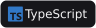
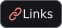
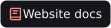

# [Sam @yungsamd17](https://yungsamd17.github.io/)

## Docs

The docs cover site structure, content editing, themes, translations, and deployment.

To run the site locally, see [Getting Started](https://github.com/yungsamd17/yungsamd17.github.io/blob/main/docs/README.md#getting-started).

The source code is available under the [MIT License](LICENSE).
