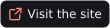
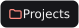
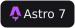
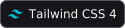

# Sam @yungsamd17

My personal website and portfolio for the browser extensions, userscripts, Android apps, and web tools I build. It’s also where you can find my links and get in touch.

[](https://yungsamd17.github.io/)
[](https://yungsamd17.github.io/projects/)
[](https://yungsamd17.github.io/links/)

## Built with





- **Astro 7** builds the static pages and sitemap.
- **Tailwind CSS 4** styles the site, with Inter served locally.
- **TypeScript** handles project data, English and Slovak translations, and browser interactions.
- **sharp** generates icons and social preview images at build time.

GitHub Actions builds and publishes the site to GitHub Pages on every push to `main`. [Deployment workflow](.github/workflows/deploy.yml)

## Run it locally

Use Node.js 22 or newer.

```sh
npm install
npm run dev
```

Open `http://localhost:4321`. Run `npm test` for regression checks. Run `npm run build` before testing to include checks against the generated files in `dist/`. Use `npm run preview` to browse that build.

## Docs

[](docs/README.md)

The docs cover site structure, content editing, themes, translations, and deployment. [License](LICENSE)
