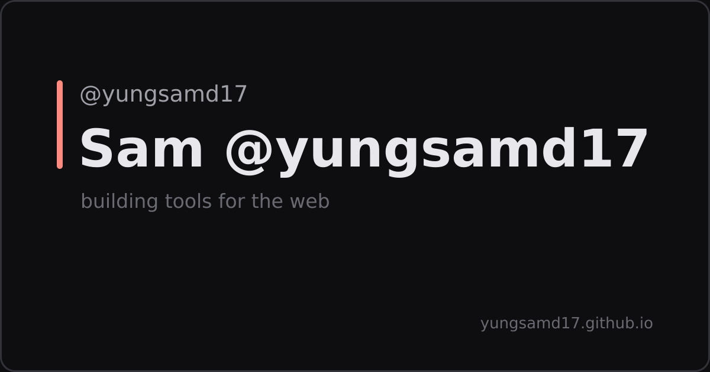

# Website Documentation

Documentation for [yungsamd17.github.io](https://yungsamd17.github.io) - Sam's personal website.

## Table of Contents
- [Tech Stack](#tech-stack)
- [Project Structure](#project-structure)
- [Getting Started](#getting-started)
- [Content Editing](#content-editing)
- [Design System](#design-system)
- [Experimental Options](#experimental-options)
- [Theme System](#theme-system)
- [Translation System](#translation-system)
- [Toasts](#toasts)
- [Links Page: Copy Email](#links-page-copy-email)
- [Scroll Behavior](#scroll-behavior)
- [Contribution Graph](#contribution-graph)
- [GitHub Stars on /projects](#github-stars-on-projects)
- [Adding a New Language](#adding-a-new-language)
- [Easter Eggs](#easter-eggs)
- [404 Page](#404-page)
- [Dynamic OG Images](#dynamic-og-images)
- [Icons & Manifest](#icons--manifest)
- [Downloader](#downloader)
- [Deployment](#deployment)
- [Commit Message Types](#commit-message-types)

---

## Tech Stack

| Tool | What it does |
|------|--------------|
| [Astro 7](https://astro.build) | Static site framework — zero JS by default |
| [Tailwind CSS 4](https://tailwindcss.com) | Utility-first styling with `@theme` tokens |
| [TypeScript](https://www.typescriptlang.org) | Strict typing across data, i18n and scripts |
| [@fontsource-variable/inter](https://fontsource.org/fonts/inter) | Self-hosted Inter, no font CDN |
| [GitHub Actions](https://github.com/features/actions) | Build & deploy on every push |

---

## Project Structure

```
yungsamd17.github.io/
├── astro.config.mjs         # Astro config (site URL, sitemap filter, Tailwind)
├── package.json
├── tsconfig.json
├── scripts/
│   ├── generate-icons.mjs   # sharp: renders PNG icons from public/logo.jpg (prebuild)
│   └── publish-404.mjs      # copies dist/404.html to dist/404/index.html (postbuild)
├── public/                  # Static files served as-is
│   ├── favicon.ico
│   ├── icon-512.png / icon-maskable.png / apple-touch-icon.png  # generated by prebuild
│   ├── site.webmanifest
│   ├── logo.jpg             # OG image fallback + source for the generated icons
│   ├── avatar.jpg           # profile picture (hero + easter egg), generated by prebuild
│   ├── robots.txt
│   ├── projects/            # project icons (SVG)
│   └── downloader/          # BetterDiscord downloader tool (vanilla JS)
├── src/
│   ├── components/
│   │   ├── BaseHead.astro      # SEO meta, per-route OG images, no-FOUC theme/lang script
│   │   ├── Contributions.astro # GitHub contribution calendar (home page)
│   │   ├── Footer.astro
│   │   ├── Icon.astro          # Inline SVG renderer (paths live in src/icons.ts)
│   │   ├── LangToggle.astro    # Language toggle button
│   │   └── ThemeToggle.astro
│   ├── data/
│   │   └── site.ts             # All content: socials, featured, projects, links
│   ├── i18n/
│   │   └── ui.ts               # UI strings (en / sk)
│   ├── icons.ts                # SVG path data + IconName union type
│   ├── layouts/
│   │   └── BaseLayout.astro
│   ├── lib/
│   │   └── contributions.ts    # Contribution fetch + fingerprint helpers
│   ├── pages/
│   │   ├── index.astro         # Home
│   │   ├── projects.astro      # Build-time GitHub stars via API
│   │   ├── links.astro         # Link-in-bio page (+ copy-email button)
│   │   ├── extras.astro        # Experimental/legacy toggles (excluded from sitemap)
│   │   ├── 404.astro
│   │   └── og/[slug].png.ts    # Dynamic 1200×630 OG share cards (sharp)
│   ├── scripts/
│   │   └── app.ts              # Client JS: theme, lang, toasts, age, easter eggs
│   └── styles/
│       └── global.css          # Design tokens, classic + redesign styles, motion
├── docs/                    # This documentation
└── .github/
    ├── FUNDING.yml
    └── workflows/deploy.yml # Build & deploy to GitHub Pages
```

---

## Getting Started

### Prerequisites

- **Node.js** 22+ (Astro 7 requirement — LTS recommended)
- **npm** (comes with Node)

### Clone & run locally

```bash
git clone https://github.com/yungsamd17/yungsamd17.github.io.git
cd yungsamd17.github.io
npm install     # install dependencies
npm run dev     # dev server at localhost:4321 with hot reload
```

### Production build

```bash
npm run build      # production build → dist/
npm run preview    # serve dist/ locally to verify the build
```

---

## Content Editing

Almost all content lives in **`src/data/site.ts`**:

- `SITE` — name, handle, email, birth date
- `SOCIALS` — home page social icons
- `FEATURED` — featured project cards on home
- `PROJECTS` — cards on `/projects`
- `LINKS` — rows on `/links`

A project entry accepts a few optional extras:

| Field | Purpose |
|-------|---------|
| `projectIcon` | SVG icon shown in the redesign card (path under `public/`) |
| `icon` | Icon path (starting with `/`) used when there is no `projectIcon` |
| `mono` | Monogram text for icon-less cards (defaults to the first letter) |
| `iconBg` | Overrides the icon tile background |
| `accent` | Card glow colour (`--accent`) |
| `repo` | `owner/name` — enables the GitHub star counter |
| `site` | Live site URL — the card's main link |
| `archived` | Shows the orange "Public Archive" badge |

UI labels and toast messages live in **`src/i18n/ui.ts`**. Edit, save, and the dev server hot-reloads.

---

## Design System

Tokens live in `src/styles/global.css` and are mapped into Tailwind via `@theme inline`:

| Token | Dark | Light | Purpose |
|-------|------|-------|---------|
| `--bg` | `#0e0e10` | `#e8e8ec` | Page background |
| `--accent` | `#ff8a80` | `#ff8a80` | Brand coral |
| `--hi` | `#e8e8ec` | `#1a1a1a` | Primary text |
| `--mid` | `#6a6a72` | `#6a6a72` | Secondary text |
| `--lo` | `#32323a` | `#c8c8d0` | Borders, elevated surfaces |
| `--dim` | `#2a2a3080` | `#fafafa80` | Card backgrounds |
| `--item` | `#a0a0a8` | `#4a4a4a` | Link/text items |

Classic component classes mirror v1: `.page`, `.link-list`, `.featured-link`, `.nav-btn`, `.proj-item`, `.about-text`, `.chip`, `.tag`, plus the radial gradient body background and the 500px column layout.

App-like viewport behavior: `html` gets a definite height and `body` uses `min-height: 100dvh`, so pages fit the visible screen exactly (no browser-toolbar overflow) and only scroll when content genuinely exceeds it.

### Classic vs. redesign

The site ships two layouts behind one gate: the **redesign** (newer card-based layout) is active by default, the **classic** v1 layout stays fully intact and can be switched back at any time.

- The gate is the `data-redesign` attribute on `<html>` — every redesign rule is scoped under `html[data-redesign]`, every classic rule stays where it was.
- The attribute is set by the no-FOUC inline script in `BaseHead.astro` before the first paint, so the layout never flashes.
- `html[data-redesign]` is added unless `localStorage['redesign'] === 'off'`.
- On navigation the attribute (plus the other option attributes) is copied onto the incoming document in the `astro:before-swap` handler.

Redesign-only features: the card glow, project star counts, contribution calendar, two-column links grid, centered links hero and the optional avatar easter egg.

---

## Experimental Options

`/extras` is a small lab for the optional parts of the site. Every option is a switch with a short description, stored in `localStorage` and applied to `<html>` before the first paint.

| Option | Effect on `<html>` | Storage key | Default |
|--------|--------------------|-------------|---------|
| Experimental redesign | `data-redesign="on"` | `redesign` | **on** (only `'off'` turns it off) |
| Page load text animations | (absence of `data-textanim="off"`) | `textanim` | **off** (`'on'` enables them) |
| Use classic load animation | `data-anim="bottom"` | `anim` | **off** (the redesign's staggered entrance) |
| Hide snack bar | `data-toast="off"` | `toast` | **on** (toasts hidden) |
| Page accent glow | (absence of `data-pageglow="off"`) | `pageglow` | **off** (only `'on'` enables the soft radial glow) |
| Avatar rain easter egg | `data-avataregg="on"` | `avataregg` | **off** (`'on'` enables the hero avatar click) |

The switches are plain checkboxes with `role="switch"`; the visible 46×26 track is a styled `.switch-ui` sibling. Toggling one writes the key, updates the attribute and shows a confirmation toast.

The theme switch transition is picked separately, with an accessible radio group (`fieldset` + real `input type="radio"`, name `theme-transition`) in the "Theme switch transition" group. Selecting a mode saves `localStorage['themetransition']` immediately — it is used the next time a theme toggle runs, nothing changes on select.

| Mode | Effect |
|------|--------|
| `none` | Instant swap |
| `fade` | Short-lived CSS colour transitions across the page (~300ms) |
| `crossfade` | View Transitions API crossfade — **default** |
| `circle` | Clip-path circle growing out of the theme button (~500ms) |
| `wipe` | Clip-path inset wipe, top to bottom (~500ms) |

`crossfade`, `circle` and `wipe` need `document.startViewTransition`; without it, or with `prefers-reduced-motion: reduce`, the switch falls back to instant rather than a half-animated page.

---

## Theme System

Three modes cycled by the header toggle: **system → light → dark → system**. `system` (monitor icon) is the default and follows the OS preference live.

Two attributes on `<html>` drive everything:

- `data-theme` — the *resolved* theme (`light` / `dark`), used by all CSS tokens
- `data-theme-mode` — the *chosen* mode (`system` / `light` / `dark`), used for the toggle icon (monitor / sun / moon) and resolution

How it works:

1. **No-FOUC:** an inline script in `BaseHead.astro` reads `localStorage['theme']` and applies the resolved theme before first paint (the same script also applies the experimental options and the manual scroll restoration)
2. **CSS:** tokens flip under `[data-theme="light"]`; dark is the markup default
3. **Persistence:** `localStorage['theme']` stores `'system'`, `'light'` or `'dark'` (older `'light'`/`'dark'` values remain valid)
4. **Live OS changes:** a `matchMedia('(prefers-color-scheme)')` listener re-resolves while in system mode
5. **View Transitions:** `astro:before-swap` copies both attributes onto the incoming page so navigation never resets your choice
6. **Switch transition:** the chosen mode drives `applyTheme()`. `fade` adds `.theme-transition` to `<html>` for one shared 300ms sweep, so every element fades its colours on the same clock instead of some snapping. `crossfade`, `circle` and `wipe` snapshot the whole page with the View Transitions API — every component, text run and card changes at the exact same instant — scoped to a temporary `html.theme-vt` class (plus `data-theme-vt`) so Astro's own page navigation transitions are untouched. The class is removed when the transition finishes or is skipped.

---

## Translation System

Fully static bilingual rendering — **both languages are in the HTML**, one is hidden by CSS:

```html
<span data-lang="en">building tools for the web</span>
<span data-lang="sk">tvorím nástroje pre web</span>
```

```css
:root[lang="sk"] [data-lang="en"] { display: none !important; }
```

Language selection flow:

1. **First visit:** the no-FOUC script in `BaseHead.astro` detects the browser languages (`navigator.languages`) — any Slovak variant picks `sk`, everything else picks `en`
2. **Manual switch:** the header toggle flips `en` ↔ `sk`
3. **Persistence:** `localStorage['lang']` always wins over detection on later visits

Switching only sets `<html lang>` + storage — zero content swapping, works without JS after first choice.

The tagline rotates through two phrases per language every 8 seconds and fades between them; the rotation restarts when the language changes.

---

## Toasts

Manual theme/language changes confirm themselves with a small pill toast (bottom center, auto-hides after 2s):

- Created once by `showToast()` in `app.ts` as `#toast` with `role="status"` for screen readers
- Styled purely from design tokens (`--lo` background, `--hi` text, `--mid` border), so it automatically matches the active theme
- Slide-up + fade animation, disabled under `prefers-reduced-motion`
- **Theme toasts** are localized by the current site language ("Switched to dark theme" / "Prepnuté na tmavú tému")
- **Language toasts** are fixed in the target language ("Switched to English" / "Prepnuté na slovenčinu")
- **Option toasts** confirm every `/extras` toggle ("Redesign enabled", "Page glow disabled", …)
- **Copy-email + konami toasts** reuse the same system (`copiedEmail`, `toastRainbow` keys)
- `data-toast="off"` (the "Hide snack bar" option) suppresses the toast element entirely

---

## Links Page: Copy Email

The Email row on `/links` has a copy button next to the mailto link. `app.ts` binds `navigator.clipboard.writeText` to any `[data-copy]` element and confirms via toast (localized, with a failure fallback). The button's `aria-label` follows the active language via `updateToggleLabels()`.

---

## Scroll Behavior

Navigation scrolling is fully instant — no animated scroll-to-top and no animated scroll restore.

- `history.scrollRestoration` is set to `manual` (redesign only) before the first paint, so the browser never restores a stale offset by itself.
- Only the **homepage** remembers where it was left. The offset is stored per normalized path in `sessionStorage['scroll-positions']` and restored on the next visit; every other page opens at the top.
- On reload the page stays hidden (`html { visibility: hidden }`) until the remembered offset is restored, with a 300ms fallback that reveals it if the script never runs — this prevents the stale-position flash on pull-to-refresh.

---

## Contribution Graph

The home page renders a GitHub contribution calendar.

- **Build time:** `src/components/Contributions.astro` calls `fetchContributions()` in `src/lib/contributions.ts`, which reads the public [jogruber mirror](https://github-contributions-api.jogruber.de) (`?y=last` = the rolling year ending today). No token needed. If the request fails the section is simply left out of the page.
- **Fingerprint:** `contributionSignature()` hashes the dates, counts and levels, so a changed calendar is detectable.
- **Caching:** `localStorage['contrib-cache']` stores `{ at, sig }` per calendar key (`home`) with a 10-minute TTL. A matching fingerprint renders the cells instantly; only new data animates in. The client refreshes the calendar in the background when the cache is stale, and falls back to the stale copy if the network fails.
- **Tooltip:** one shared, viewport-anchored tooltip (`[data-contrib-tip]`) glides between dates instead of jumping.
- **Cell states:** empty cells use the link-card colour, past empty cells are darker, future days (on or after the day after tomorrow) are dimmed, and tomorrow stays bright.

---

## GitHub Stars on /projects

Projects with a `repo: 'owner/name'` field in `site.ts` get a live star count.

- **Build time:** `projects.astro` queries the GitHub API. When `GITHUB_TOKEN` is present in the build environment it is sent as a bearer token (5000 req/h instead of the anonymous 60 req/h). Locally: `GITHUB_TOKEN="$(gh auth token)" npm run build`.
- **Runtime:** `initProjectStars()` in `app.ts` re-checks the counts in the browser and caches them in `localStorage['stars-cache']` (6h TTL), falling back to the stale cached value when the API is rate-limited.
- Counts below 3 are hidden, so tiny repos show no chip at all.
- Lookups fail soft: if the API is unreachable or rate-limited the chip is omitted and the build still succeeds.

---

## Adding a New Language

Example: French (`fr`).

> ⚠️ The header toggle currently assumes two languages (it flips `en` ↔ `sk`). A third language requires turning it into a cycling button or a menu first.

1. **`src/data/site.ts`** — extend the `Locale` type with `'fr'` and add `fr` text to every `desc`
2. **`src/i18n/ui.ts`** — add a `fr` object with all keys from `en` (including the `toastTheme*` keys)
3. **`src/styles/global.css`** — extend the hide rules with every new language pair:
   ```css
   :root[lang="fr"] [data-lang="en"],
   :root[lang="en"] [data-lang="fr"],
   :root[lang="sk"] [data-lang="fr"],
   :root[lang="fr"] [data-lang="sk"] { display: none !important; }
   ```
4. **`src/components/BaseHead.astro`** — extend the browser-language detection (`l?.toLowerCase().startsWith('sk')` → include `'fr'`)
5. **`src/scripts/app.ts`** — extend `currentLang()` and the toggle handler in `initLang()` to cycle three languages
6. **Pages with `data-lang` blocks** (`index.astro`, `projects.astro`, `about.astro`, `404.astro`) — duplicate every marked block with `data-lang="fr"`

---

## Easter Eggs

1. **Avatar rain** (experimental, off by default). Enable it in `/extras` with "Avatar rain easter egg", then click the profile picture in the hero. Dim copies of the picture (28–48px, random static rotation) fall from the top, fade out completely by ~75% of the screen and despawn. Click the picture again to stop. Navigating away always stops it and it never restarts on its own.
2. **Console art** — open DevTools and say hi
3. **`?debug=true`** — green debug border
4. **Konami code** (↑↑↓↓←→←→BA) — rainbow hue-cycle for 8s + toast

There is one more. It is not documented here — that would ruin the fun.

---

## 404 Page

GitHub Pages only serves a custom 404 from a root-level `404.html`, so that file has to exist. To make the clean URL work too, `scripts/publish-404.mjs` runs as `postbuild` and copies it to `dist/404/index.html`, so both of these serve the page:

- `/404/` (and `/404`, which redirects to the slash), the readable link
- `/404.html`, kept only because GitHub Pages falls back to it for unknown paths

The page is marked `<meta name="robots" content="noindex">` (the `noindex` prop on `BaseLayout` / `BaseHead`) since it is a dead end, not content. Its copy lives in `notFoundTitle`, `notFoundText`, `notFoundJoke` and `notFoundHome` in `src/i18n/ui.ts`.

---

## Dynamic OG Images

`src/pages/og/[slug].png.ts` prerenders 1200×630 share cards for `/`, `/projects` and `/links` using sharp. The copy comes from `SITE` and `UI.en` so the cards stay in sync with the pages. Each card uses the site's dark background and coral accent bar with no background gradient, matching the plain page background. `BaseHead.astro` maps each route to its card and upgrades `twitter:card` to `summary_large_image`; any other route (e.g. `/extras`) falls back to `logo.jpg` + `summary`.

`docs/assets/og/` holds copies of the three generated cards for documentation, one per live OG route. An old `/about` card is not shipped because there is no about page.

Example — home page card (`docs/assets/og/`):



Text rendering needs a system font (DejaVu Sans or similar). GitHub Actions' `ubuntu-latest` has one preinstalled; on a bare Linux container without fonts, export `FONTCONFIG_FILE` pointing at a config that includes your font directory.

---

## Icons & Manifest

`npm run build` triggers `scripts/generate-icons.mjs` (prebuild), which renders `icon-512.png`, `apple-touch-icon.png` (180×180), a maskable variant, `favicon.ico` and `avatar.jpg` from `public/logo.jpg` via sharp. `site.webmanifest` references them; `BaseHead.astro` links the manifest and apple-touch-icon.

Project icons live in `public/projects/` as SVG (small and crisp at any size).

---

## Downloader

`/downloader` is a standalone vanilla-JS tool (no Astro) for downloading plugins/themes from [yungsamd17/BetterDiscordAddons](https://github.com/yungsamd17/BetterDiscordAddons). See `public/downloader/README.md` for the query format — single files (`?plugin=Name`) and batches (`?plugin=A&plugin=B&theme=C`) both work; downloads run sequentially with per-file status rows. The UI follows the site's dark/light tokens via `prefers-color-scheme` and uses inline SVG icons only (no icon CDN).

---

## Deployment

Automatic via **`.github/workflows/deploy.yml`** (official `withastro/action`):

1. Push to `main` → site builds and deploys
2. Manual runs possible via **Actions → Deploy to GitHub Pages → Run workflow**
3. One-time setup: repo **Settings → Pages → Source → GitHub Actions**

Sitemap is generated at `/sitemap-index.xml` by `@astrojs/sitemap` (the `/extras/` lab is excluded from it).

---

## Commit Message Types

Recommended commit message format for this project:

### Types:
- **feat** - New features (easter eggs, new pages, etc.)
- **fix** - Bug fixes (typos, broken functionality)
- **style** - UI/UX changes (CSS updates, layout changes)
- **refactor** - Code cleanup without changing functionality
- **docs** - Documentation updates (README, comments)
- **perf** - Performance improvements
- **chore** - Maintenance (updating deps, configs)

### Examples:
```
feat: add rainbow theme easter egg
fix: correct translation typo in Slovak about text
style: update project card hover effects
refactor: remove unused rainbow theme code
docs: add documentation for language system
chore: bump astro to latest
```

---

## License

This project is licensed under the MIT License - see the [LICENSE](../LICENSE) file for details.

---

**Last updated:** November 2026
